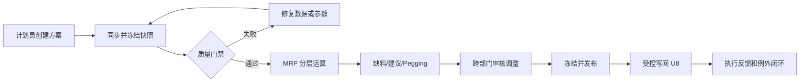

# 01　业务需求与范围

## 1. 目标

外挂 MRP 将当前“运行、导出、人工解释和线下协调”的过程，改造为“冻结输入、质量门禁、多方案计算、逐笔解释、在线审核、受控发布和执行反馈”的闭环。

## 2. 角色

| 角色 | 核心职责 |
|---|---|
| 主计划员 | 创建方案、运行 MRP、处理异常、调整和冻结建议 |
| 采购计划员 | 确认采购数量、供应商、承诺日期，反馈执行偏差 |
| 生产计划员 | 确认生产建议、开完工日、冻结区和车间约束 |
| 仓库/物控 | 确认可用库存口径、冻结和待检状态 |
| 销售/客服 | 确认需求优先级、交期和需求变更 |
| 审核人 | 审批采购/生产建议并批准写回 |
| 系统管理员 | 参数、权限、接口、任务和审计管理 |

## 3. 范围

### 3.1 第一阶段必须实现

- U8 物料、BOM、销售、采购、生产、库存数据同步
- 计划范围和参数方案管理
- 不可变数据快照及质量校验
- BOM 环路检测、有效版本选择和低层码计算
- 独立需求、相关需求、库存及在途供需平衡
- 批量、提前期和工作日历
- 采购建议、生产建议、缺料及例外消息
- Demand—Supply—Plan 逐笔 Pegging
- 方案对比、人工调整、版本冻结和审计

### 3.2 后续范围

- U8 采购申请/生产计划受控写回
- 替代料优化、委外、项目库存和自由项深化
- 产能约束、工序排程、供应商协同
- 预测消耗、ATP/CTP 和计划绩效分析

### 3.3 明确不做

- 替代 U8 库存台账和财务核算
- 直接更新 U8 主子表、现存量或凭证
- 第一阶段自动生成正式采购/生产订单
- 未定义口径时自行推断待检、冻结、项目库存是否可用

## 4. 目标流程

## 5. 关键业务口径（必须会签）

1. 可用库存是否包含待检、冻结、不良、代管、项目和调拨在途。
2. 需求维度是否按物料、仓库、自由项、项目、批号属性隔离。
3. 销售订单、预测和备货计划如何消耗及去重。
4. 采购在途、生产在制、委外和调拨供应的有效状态。
5. BOM 版本、生效日期、损耗、固定用量、虚拟件和替代料规则。
6. 安全库存、批量、提前期、冻结期和时界规则。
7. 超期需求和供应应落在哪个计划日期。

任何口径变化均形成参数版本，不能覆盖历史运行使用的版本。

