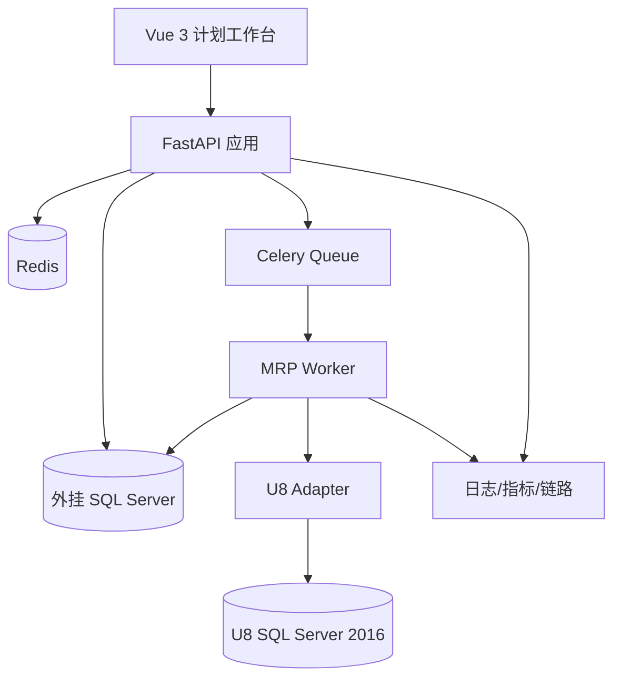

# 02　系统架构

## 1. 总体架构



## 2. 技术选型

| 能力 | 技术 | 说明 |
|---|---|---|
| HTTP API | FastAPI + Uvicorn | 类型化 API、OpenAPI、异步 I/O |
| 类型与校验 | Pydantic 2 | 请求、配置、领域边界模型 |
| 数据访问 | SQLAlchemy 2 Core/ORM | ORM 用于事务业务；Core 用于批量查询 |
| SQL Server | pyodbc + ODBC Driver 18 | U8 和外挂数据库连接 |
| 迁移 | Alembic | 只管理外挂库结构，绝不管理 U8 |
| 后台任务 | Celery | 长任务、重试、路由和并发隔离 |
| Broker/缓存 | Redis | 队列、短锁和短期缓存；不保存权威业务状态 |
| 批量处理 | 原生 Python + SQL 批处理 | 禁止 ORM 逐行插入百万级明细 |
| 观测 | OpenTelemetry + structlog | trace_id、run_id、snapshot_id 全链路 |

## 3. 模块边界

```text
src/
  mrp_app/
    api/                 # FastAPI routers、依赖和错误映射
    application/         # 用例：创建运行、审核、发布
    domain/              # 实体、值对象、规则接口
    infrastructure/      # SQL Server、Redis、认证、日志
    u8_adapter/          # U8 查询、字段映射、写回接口
    snapshot/            # 同步、标准化、质量门禁
    engine/              # 与框架无关的 MRP 纯计算模块
    workers/             # Celery tasks 和编排
    observability/       # 指标、追踪和审计
tests/
  unit/ integration/ contract/ golden/ performance/
```

依赖方向为 `api/workers → application → domain`；`infrastructure` 实现领域接口。`engine` 不允许直接 import FastAPI、Celery 或 U8 表模型。

## 4. 进程划分

- `web`：短请求、查询、审核；不执行 MRP。
- `worker-sync`：U8 同步和快照，低并发，限制生产库压力。
- `worker-mrp`：CPU/内存密集计算，按低层码分片。
- `worker-export`：Excel/大报表，避免占用 API。
- `worker-writeback`：U8 写回，单独队列、低并发、严格幂等。

## 5. 同步与异步约定

FastAPI 可使用 async 处理 HTTP，但 pyodbc 是同步驱动。数据库访问应放在线程池或采用同步路由/服务，避免假异步阻塞事件循环。MRP 运算始终由 Celery 进程执行，CPU 并行使用多进程而非线程。

## 6. 非功能目标

- API 常规查询 P95 小于 2 秒。
- 长查询强制分页；导出超过阈值转后台任务。
- 单次 MRP 失败不影响 API 和其他已完成运行。
- 所有正式结果可通过 Snapshot + 参数 + Engine Version 重放。
- U8 不可用时允许浏览历史结果，禁止静默使用过期输入发布。

