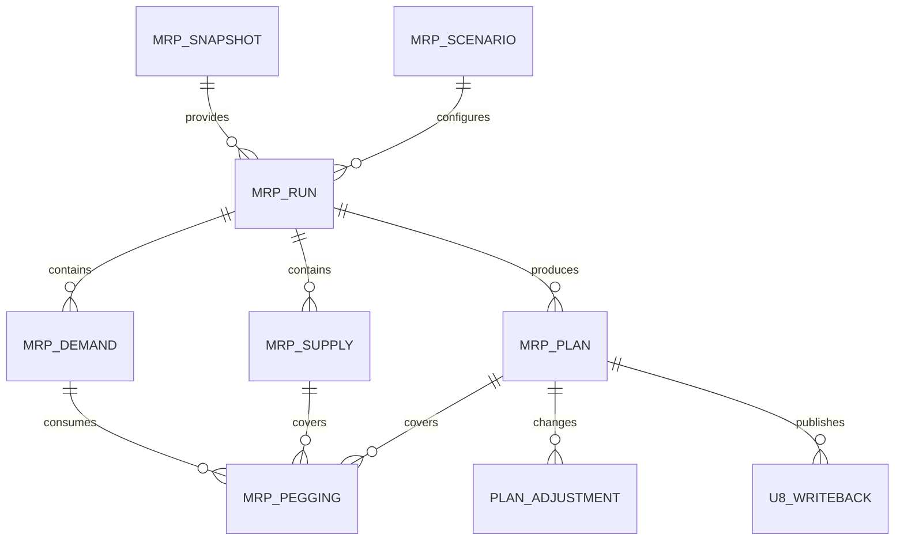

# 03　数据架构

## 1. 数据分层

| 层 | 表前缀 | 特征 |
|---|---|---|
| 同步暂存 | `stg_` | 当前抽取批次，允许清理和重试 |
| 标准镜像 | `mirror_` | U8字段映射为统一类型，保留源ID和水位 |
| 快照 | `snap_` | 按 Snapshot ID 不可变，作为运算唯一输入 |
| 运算输入 | `mrp_demand/supply` | 标准化的需求、供应和计划维度 |
| 运算结果 | `mrp_plan/pegging/exception` | 建议、挂接、例外和指标 |
| 协同 | `plan_adjustment/approval` | 人工调整、审核和冻结版本 |
| 集成审计 | `u8_writeback/audit_event` | 请求、响应、幂等和审计证据 |

## 2. 核心实体



关键表：

- `mrp_snapshot(snapshot_id, cutoff_time, source_watermark, status, checksum)`
- `mrp_run(run_id, snapshot_id, scenario_id, scope_json, status, engine_version)`
- `mrp_demand(demand_id, run_id, item_dim_key, need_date, open_qty, priority, source_ref)`
- `mrp_supply(supply_id, run_id, item_dim_key, available_date, open_qty, firm_flag, source_ref)`
- `mrp_plan(plan_id, run_id, order_type, item_dim_key, qty, release_date, due_date, status, version)`
- `mrp_pegging(pegging_id, run_id, demand_id, supply_id, plan_id, matched_qty, bom_path)`
- `mrp_exception(exception_id, run_id, type, severity, object_ref, payload_json, status)`
- `u8_writeback(line_id, plan_id, idempotency_key, request_json, u8_doc_no, status)`

## 3. 计划维度键

`item_dim_key` 不能只有存货编码。推荐由配置决定参与维度：

```text
item_code | warehouse_group | free_item_1..10 | project_code | batch_attribute
```

维度值规范化后计算稳定哈希，同时保存可读列。不同维度的供需默认不得互相冲抵；允许合并时必须通过明确规则。

## 4. 数值与日期

- 数量、金额、换算率使用 `DECIMAL` 和 Python `Decimal`，禁止 float。
- 数据库存 UTC 或明确的企业本地时间；业务日期使用 `date`。
- 所有数量保存基础计量单位，同时保存源单位和换算率。
- 超期对象保留原日期，并额外计算 `effective_date`，不得篡改源日期。

## 5. 索引与分区

重点索引：

- `(run_id, item_dim_key, need_date, priority)`
- `(run_id, item_dim_key, available_date)`
- `(run_id, low_level_code)`
- `(run_id, status)`
- `u8_writeback(idempotency_key)` 唯一索引

大表按运行月份或 Run ID 范围归档。在线保留期建议 12–24 个月，历史快照压缩归档；审计和写回记录按合规要求保留。

## 6. 数据质量

阻断项：BOM 环路、无效单位换算、主子表断裂、需求数量无法解析、关键日期缺失。警告项：负库存、超期供应、提前期缺失但有默认值、长期未维护BOM。门禁结果必须保存规则编号、对象、严重度和证据。

