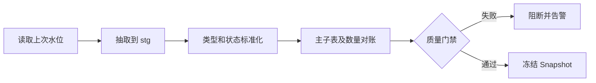

# 05　U8 集成设计

## 1. 边界

`u8_adapter` 是唯一允许理解 U8 表名、字段名和状态码的模块。其输出为标准模型，MRP 引擎不执行 U8 SQL。

参考源对象包括：

- `Inventory`：物料档案
- `bom_bom`、`bom_parent`、`bom_opcomponent`：BOM
- `SO_SOMain`、`SO_SODetails`：销售需求
- `PO_Pomain`、`PO_Podetails`：采购供应
- `mom_order`、`mom_orderdetail`、`mom_moallocate`：生产与材料需求
- 现存量、库存收发、采购申请、委外、调拨、工作日历等对象

正式映射必须由 U8 顾问结合版本和二开确认。

## 2. 连接安全

- 使用专用只读账号，只授权白名单对象；禁止使用 `sa`。
- 密码存储在环境密钥系统，不进入源码、配置样例或日志。
- ODBC 连接启用加密和证书校验；过渡期若使用 `TrustServerCertificate` 必须登记风险。
- 设置连接、查询和锁等待超时；同步任务限制并发。

## 3. 增量同步

每个对象配置独立策略：

| 水位类型 | 适用情况 | 方法 |
|---|---|---|
| rowversion | 有稳定行版本 | 保存最后二进制水位 |
| 修改时间 | 字段可靠且有索引 | 水位减回看窗口，按主键去重 |
| 递增ID | 只新增或修改可另行捕获 | 保存最大ID |
| 业务日期 | 老表缺少技术水位 | 按日期回看并做内容哈希 |
| 周期全量 | 小型档案表 | 全量对比软删除 |

不能假定所有 U8 表都有可靠修改时间。主子表同步必须属于同一批次，并记录源行数、最大ID、最小/最大业务日期和关键数量汇总。

## 4. 快照流程

快照冻结后不更新。源数据变化生成新快照；禁止在运行中“补写”当前快照。

## 5. 写回策略

优先顺序：U8 官方 API/EAI → 官方单据导入 → 经厂商确认的接口表。禁止直接拼接U8业务主子表。

写回流程：

1. 计划版本冻结并审批。
2. 生成唯一 `idempotency_key`。
3. 预校验档案、期间、状态和数量。
4. 本地写入 `PENDING`，调用 U8。
5. 成功后反查 U8 ID/单号，更新 `CONFIRMED`。
6. 超时标记 `UNKNOWN`，先反查，不盲目重发。
7. 已生成单据的撤销走 U8 作废/变更流程。

## 6. 契约测试

对每个适配器建立脱敏样本和契约测试：字段类型、NULL、状态码、单位、日期、主子表关系。U8补丁或二开变更前后运行全套契约测试，差异未经确认不得上线。

