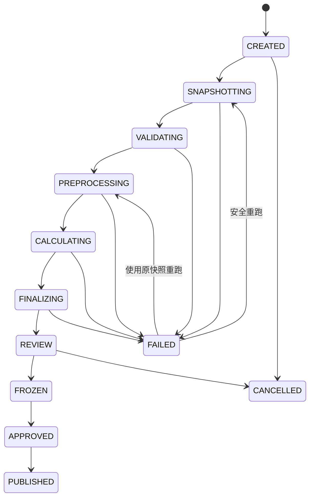

# 07　任务与状态机

## 1. 任务编排

Celery 只负责投递和执行，权威任务状态保存在 SQL Server，不以 Redis 结果作为业务事实。



## 2. 任务拆分

```text
create_snapshot(run_id)
validate_snapshot(run_id)
prepare_bom(run_id)
build_initial_demand_supply(run_id)
calculate_level(run_id, level_no, shard_no)
merge_level(run_id, level_no)
generate_exceptions(run_id)
finalize_run(run_id)
```

层内分片可以并行；下一层必须等待当前层全部分片成功并完成合并。

## 3. 幂等与租约

- 每个任务键：`run_id + stage + level + shard + attempt_generation`。
- 开始执行前以数据库条件更新获取租约，租约有到期时间和心跳。
- 任务重投时先检查阶段是否完成；完成则直接返回。
- 分片写入临时代次，合并成功后切换可见代次，避免半成品结果。
- 取消使用数据库标志和 Celery revoke 组合；引擎在安全点主动检查取消标志。

## 4. 重试分类

| 类型 | 示例 | 策略 |
|---|---|---|
| 瞬时错误 | 网络、死锁、Redis短暂不可用 | 指数退避并加入抖动 |
| 数据错误 | BOM环路、无单位换算 | 不自动重试，进入质量问题 |
| 业务冲突 | 快照过期、计划已冻结 | 不重试，返回明确状态 |
| 未知写回 | U8超时 | 先反查，禁止直接重发 |
| 程序缺陷 | 未处理异常 | 标记失败、保存证据并人工处理 |

## 5. 检查点

检查点保存：阶段、低层码、分片、输入行数、输出行数、校验和、开始结束时间和代码版本。重跑前核对快照与引擎版本；版本变化默认创建新 Run，不在原 Run 上混算。

## 6. 并发限制

- 同一计划范围默认只允许一个正式 Run 处于计算阶段。
- 模拟 Run 可并行，但设全局并发和内存上限。
- U8同步队列并发1–2，写回队列并发1，防止压垮U8。
- Redis锁只用于快速互斥，数据库唯一约束是最终防线。

