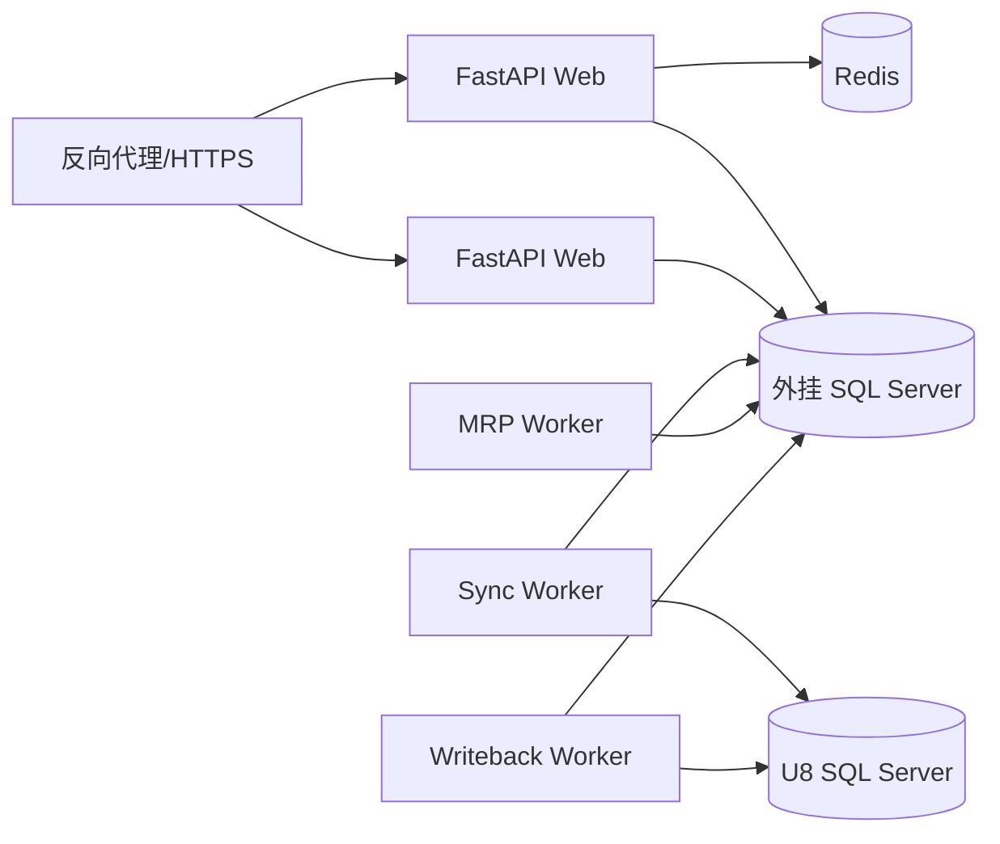

# 09　部署与运维

## 1. 推荐拓扑

U8服务器不部署外挂计算程序。生产环境至少将外挂数据库与U8数据库隔离；MRP Worker按内存和CPU单独规划。

## 2. 部署选择

优先使用企业现有容器平台。若无容器运维能力，可在Windows/Linux虚机上使用受控Python环境和系统服务。容器内一个Uvicorn主进程；副本由平台管理。单机部署可配置多个Web worker，但MRP仍是独立Celery进程。

## 3. 环境

- `dev`：合成/脱敏数据，不连接生产U8。
- `test`：固定黄金数据集和接口模拟器。
- `staging`：生产规模脱敏副本，用于性能和恢复演练。
- `prod`：最小权限、审批发布、变更窗口。

禁止用生产 `sa` 进行开发或测试。

## 4. 配置

采用环境变量/密钥库注入，Pydantic Settings启动时校验。配置包括数据库、Redis、OIDC、任务并发、超时、功能开关和写回总开关。业务规则保存在数据库并版本化，不通过环境变量临时修改。

## 5. 可观测性

指标：API P95、错误率、连接池使用率、同步行数和水位、快照耗时、各低层码耗时、处理物料数/秒、Worker内存、队列深度、异常数量、写回成功率。

日志统一携带 `trace_id, run_id, snapshot_id, task_id, batch_id`；禁止打印完整业务载荷和凭据。运行级仪表板应显示输入行数、输出行数、阶段耗时和失败位置。

## 6. 备份与恢复

- 外挂数据库每日全备并按RPO增加差异/日志备份。
- 备份至少一份异机保存，定期恢复演练。
- Redis不作为权威存储，可从数据库重建任务状态。
- 保存Python制品、迁移脚本、参数版本和引擎版本，确保结果可重放。

## 7. 容量初始估算

容量取决于快照频率和Pegging明细。PoC阶段实际测量每次Run的需求、供应、计划和Pegging行数，再确定保留周期。重点监控 `mrp_pegging`、快照表、导出文件和审计日志，禁止无限保留在线明细。

## 8. 发布

采用向前兼容数据库迁移：先扩展结构、部署兼容代码、回填、切换，最后再删除旧字段。引擎升级创建新 `engine_version`；正在运行的Run继续使用原版本制品或被安全取消后重建。

